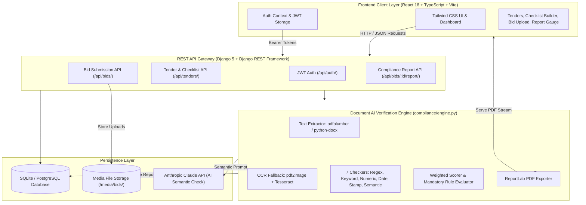
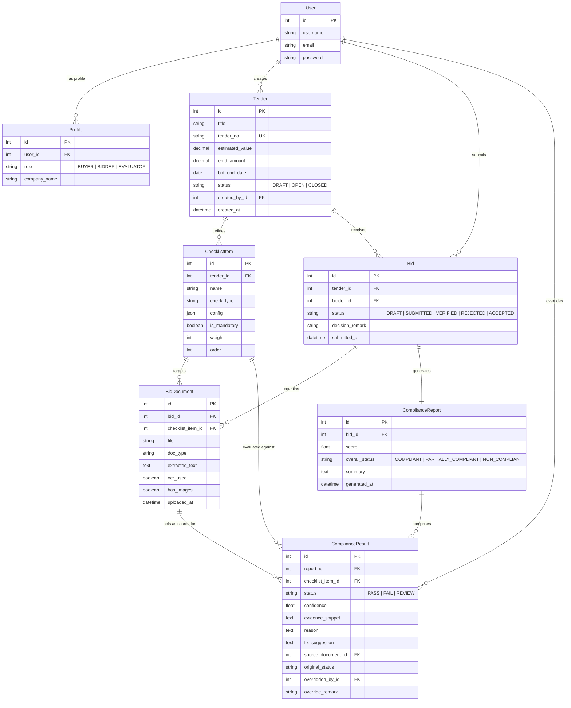
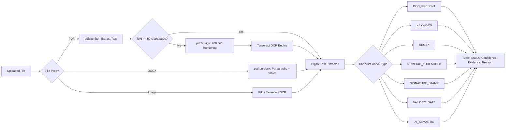
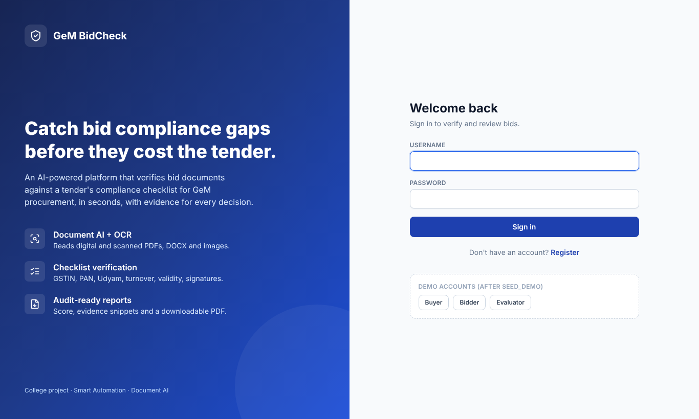
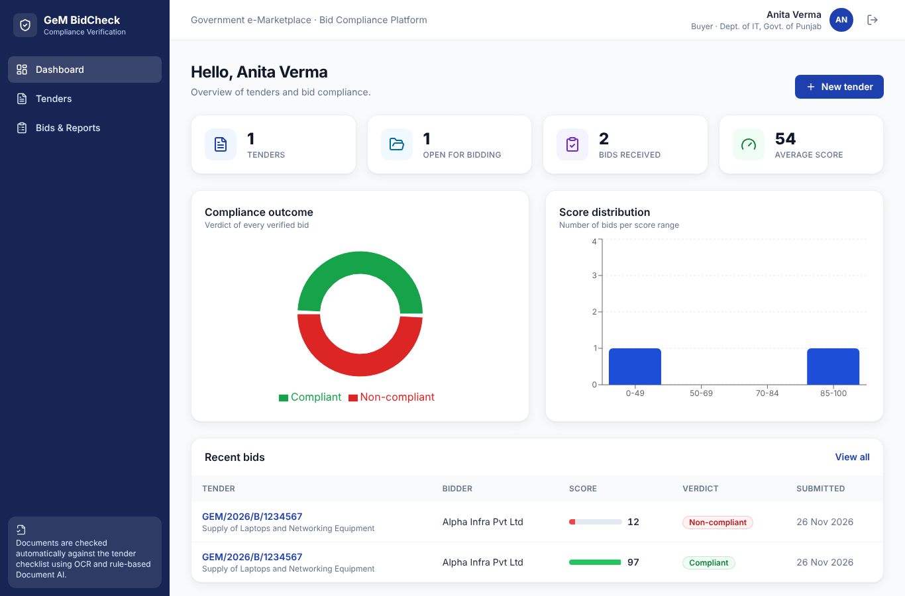
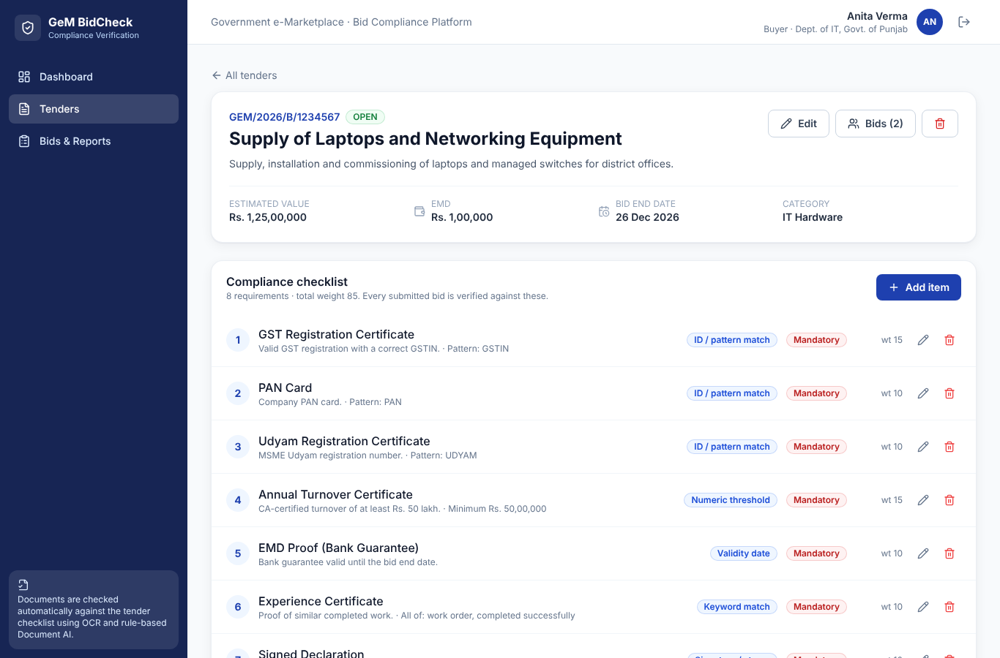
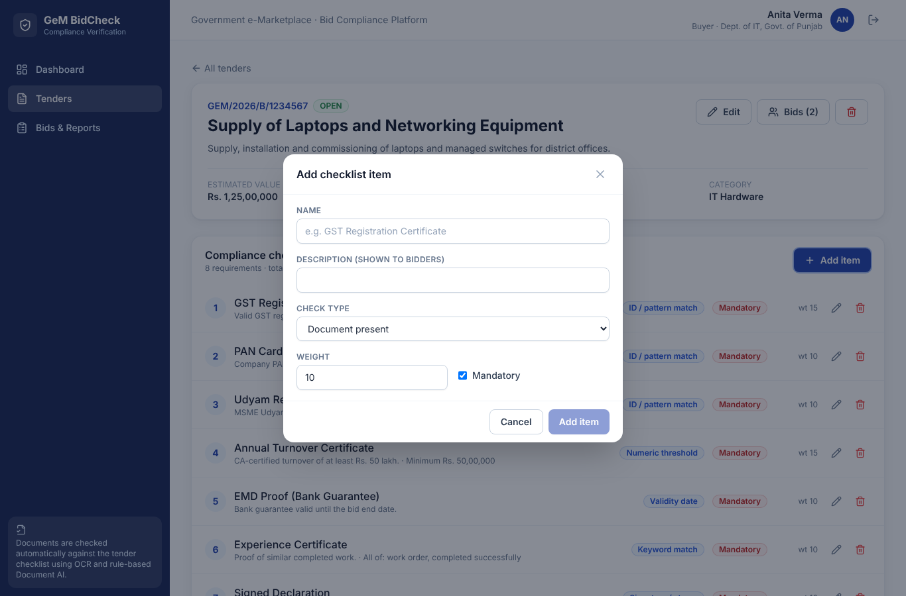
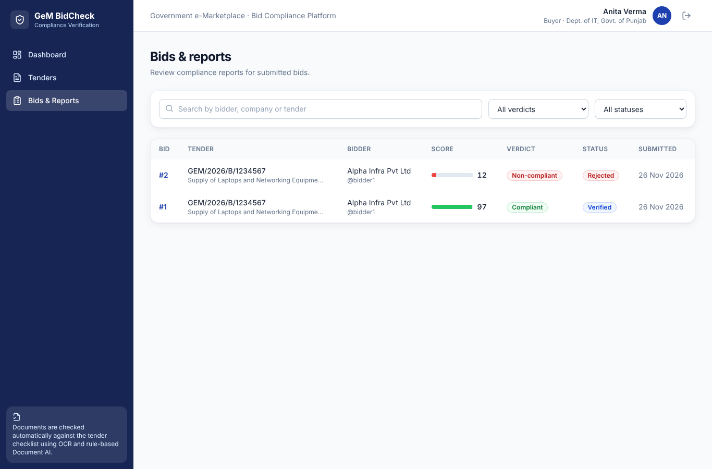
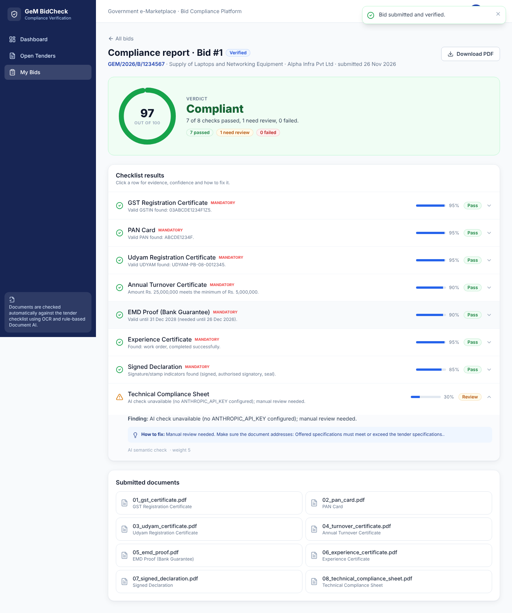
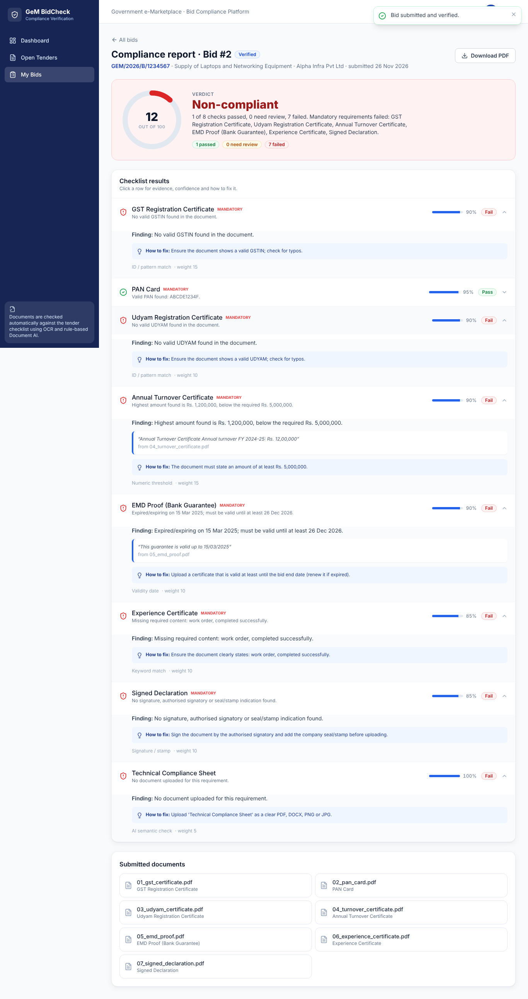

# GeM BidCheck: AI-Powered Integrated Bid Compliance Verification Platform
## Project Report & Technical Documentation

---

## 1. Abstract

Public procurement in India via the Government e-Marketplace (GeM) processes lakhs of crores in annual procurement transactions. However, a significant fraction of technical bids submitted by micro, small, and medium enterprises (MSMEs) and vendors face summary rejection during technical evaluation due to minor, avoidable clerical errors in uploaded documentation—such as missing authorized signatory stamps, expired tax/validity certificates, turnover figures falling marginally below criteria, or typographical mismatches in GSTIN and PAN registrations.

**GeM BidCheck** is an automated, AI-powered document compliance verification platform tailored for GeM procurement workflows. Built using Django 5, Django REST Framework, and React 18 with TypeScript and Tailwind CSS, the platform extracts text from uploaded multi-format tender documents (digital PDFs, scanned PDFs via Tesseract OCR fallback, DOCX files, and scanned images). It executes a multi-stage verification pipeline across seven specialized check types (`DOC_PRESENT`, `KEYWORD`, `REGEX`, `NUMERIC_THRESHOLD`, `SIGNATURE_STAMP`, `VALIDITY_DATE`, and `AI_SEMANTIC`). The system calculates an item-weighted compliance score (0–100), assigns an audit-backed verdict (**Compliant**, **Partially Compliant**, or **Non-compliant**), isolates exact quote snippets as audit evidence, and provides actionable "how-to-fix" remediation guidance for vendors. Evaluators retain full oversight through audit-logged manual overrides and downloadable PDF verification reports.

---

## 2. Problem Statement

On public procurement portals such as GeM, government buyers publish tenders with rigorous eligibility checklists. Bidders submit extensive documentation packets containing GST registrations, PAN cards, Udyam certificates, audited balance sheets, EMD bank guarantees, and technical compliance sheets.

1. **High Disqualification Rate due to Clerical Mistakes**: Legitimate suppliers are disqualified because of inadvertent omissions (e.g., omitting the words "Authorized Signatory", uploading an expired certificate, or failing to meet minimum turnover thresholds).
2. **Labor-Intensive Evaluation**: Government evaluators manually review hundreds of multi-page PDF documents per tender, leading to multi-week evaluation delays and subjective inconsistencies.
3. **Lack of Immediate Pre-Submission Feedback**: Bidders currently receive no automated pre-screening feedback prior to bid closure, forfeiting their opportunity to rectify simple formatting or documentation issues.
4. **Auditability and Dispute Bottlenecks**: Procurement disputes often stem from opaque evaluation remarks. There is an absence of automated, snippet-level evidence generation supporting acceptance or rejection decisions.

---

## 3. Objectives

The primary objectives of the GeM BidCheck platform are:
- **Automated Multi-Format Ingestion**: Ingest and extract text seamlessly from native digital PDFs, scanned PDFs, Microsoft Word DOCX files, and raw images (PNG/JPG).
- **Intelligent Multi-Heuristic Verification**: Implement specialized verification algorithms covering pattern matching (regex), fuzzy keyword alignment, monetary threshold parsing, date validity checking, signature/stamp detection, and semantic requirement matching.
- **Explainable Evidence Generation**: Extract precise context snippets (evidence quotes) and confidence ratings for every checklist verification item.
- **Actionable Remediation Guidance**: Formulate human-readable "how-to-fix" hints for every failed or review-flagged document, enabling bidders to rectify defects.
- **Transparent Role-Based Governance**: Deliver distinct role-based access for Buyers, Bidders, and Evaluators with audit-logged manual override capabilities and one-click PDF compliance report generation.

---

## 4. Scope

### In-Scope
- **Role-Based Access Control (RBAC)**: Secure JWT-authenticated workflows for **Buyer / Admin**, **Bidder**, and **Evaluator** roles.
- **Tender & Dynamic Checklist Management**: Creation and customization of tender requirements with weighted checklist items and mandatory/optional flags.
- **Multi-Document Bid Ingestion**: Single-action or bulk multi-document upload per tender requirement with instant client-side upload feedback.
- **Automated Compliance Engine**:
  - Digital text extraction via `pdfplumber` and `python-docx`.
  - Fallback OCR via `pdf2image` and `pytesseract` for scanned or low-density documents.
  - Multi-rule validation across 7 check types.
  - Weighted scoring algorithm with strict mandatory-failure gates.
- **Buyer & Evaluator Review Console**: Discrepancy inspection, auditable manual overrides with required justification remarks, bid acceptance/rejection, and downloadable formal PDF summary reports.

### Out-of-Scope (Future Enhancements)
- Asynchronous distributed task queue execution (Celery/Redis worker nodes) for ultra-high concurrency.
- Direct API integration with live government databases (direct GSTN / Income Tax / MCA API lookups).
- Native biometric or cryptographic digital signature (DSC) token parsing (current implementation detects visual and text-based signature/seal indicators).

---

## 5. System Architecture

The platform follows a decoupled, three-tier architecture comprising a modern Single Page Application (SPA) frontend, a stateless RESTful backend API with a modular compliance engine, and an ACID-compliant persistence layer.



### Architectural Data Flow:
1. **Authentication**: Users log in via `/api/auth/login/` and receive short-lived JWT access and refresh tokens stored in memory/local storage.
2. **Checklist Definition**: Buyers create a tender and configure checklist rules specifying check types, regex expressions, keywords, or numeric thresholds.
3. **Bid Ingestion**: The Bidder submits a bid via multipart form data (`POST /api/tenders/<id>/bids/`). Files are saved to `media/bids/<tender_id>/<bid_id>/`.
4. **Synchronous Verification**:
   - `extract_text()` attempts high-speed digital extraction. If page character density is below 50 characters/page, it automatically invokes `pdf2image` and `pytesseract`.
   - The engine maps each checklist item to its respective checker in `CHECKERS`.
   - Results are persisted as `ComplianceResult` records linked to a master `ComplianceReport`.
5. **Score & Verdict Computation**: `recompute_report()` tallies weighted scores and enforces mandatory constraints.
6. **Reporting**: Results are rendered on an interactive frontend gauge and can be exported as an official PDF generated via ReportLab.

---

## 6. Modules Description

### 6.1 `accounts`
- **Responsibilities**: User registration, profile management, and role-based permissions.
- **Key Classes**:
  - `Profile`: One-to-one extension of Django's `User` model storing `Role` (`BUYER`, `BIDDER`, `EVALUATOR`) and `company_name`.
  - `seed_demo`: Management command populating demo users (`buyer`, `evaluator`, `bidder1`, `bidder2`) with pre-configured tenders and sample documents.

### 6.2 `tenders`
- **Responsibilities**: Tender lifecycle management and dynamic checklist creation.
- **Key Classes**:
  - `Tender`: Stores tender number (`tender_no`, e.g., `GEM/2026/B/1234567`), estimated value, EMD amount, bid end date, status (`DRAFT`, `OPEN`, `CLOSED`), and owner.
  - `ChecklistItem`: Configurable requirements with `check_type`, JSON configuration (`config`), mandatory flag (`is_mandatory`), weight (e.g., 10–20 points), and display order.

### 6.3 `bids`
- **Responsibilities**: Bid submission and document storage.
- **Key Classes**:
  - `Bid`: Associates a tender with a bidder, status (`DRAFT`, `SUBMITTED`, `VERIFIED`, `ACCEPTED`, `REJECTED`), and buyer decision remarks.
  - `BidDocument`: Holds the uploaded document file, document type, extracted text, and extraction flags (`ocr_used`, `has_images`).

### 6.4 `compliance`
- **Responsibilities**: Document AI extraction, rule execution, scoring, audit tracking, and PDF compilation.
- **Key Classes**:
  - `ComplianceReport`: Tracks overall bid score (0–100), overall verdict (`COMPLIANT`, `PARTIALLY_COMPLIANT`, `NON_COMPLIANT`), summary, and consistency findings.
  - `ComplianceResult`: Per-item verification outcome storing status (`PASS`, `FAIL`, `REVIEW`), confidence (0.0–1.0), snippet evidence, reason, fix suggestion, source document link, and override audit fields (`overridden_by`, `override_remark`, `original_status`).
  - `engine.py`: Core verification engine containing text extraction pipelines, the 7 checker implementations, and scoring algorithms.
  - `pdf_report.py`: Automated generation of styled, multi-page compliance reports using ReportLab.

### 6.5 `frontend`
- Built with React 18, Vite, TypeScript, and Tailwind CSS.
- **Pages**: Login, Registration, Buyer/Bidder Dashboard (with Recharts compliance distributions), Tender List/Form/Detail, Checklist Item Builder modal, Bid Submission with Drag-and-Drop file staging, Bids Review List with status filters, and the detailed Bid Compliance Report view with circular score gauge, expandable item evidence, and manual override dialog.

---

## 7. Database Design (Entity-Relationship)

The relational schema ensures referential integrity, cascading updates, and comprehensive auditability:



---

## 8. Verification Pipeline & The 7 Check Types



### Detailed Breakdown of the 7 Check Types:

1. **`DOC_PRESENT` (Document Presence & Basic Legibility)**:
   - Validates that a non-empty document was provided.
   - Evaluates whether extracted text contains at least 20 readable characters. Returns `PASS` (0.95 confidence) if legible; returns `REVIEW` (0.40 confidence) if unreadable or blank.

2. **`KEYWORD` (Fuzzy Keyword Matching)**:
   - Supports `"all"` or `"any"` matching modes.
   - Leverages `rapidfuzz.fuzz.partial_ratio_alignment` with a threshold of $\ge 88$ to match terms despite OCR noise or slight phrasing variations.
   - Returns `PASS` with proportional confidence or `FAIL` listing missing keywords.

3. **`REGEX` (Identifier & Pattern Matching)**:
   - Evaluates standard statutory Indian tax/business identifiers using compiled regular expressions:
     - **GSTIN**: `\b\d{2}[A-Z]{5}\d{4}[A-Z][1-9A-Z]Z[0-9A-Z]\b`
     - **PAN**: `\b[A-Z]{5}\d{4}[A-Z]\b`
     - **UDYAM**: `\bUDYAM-[A-Z]{2}-\d{2}-\d{7}\b`
     - **CIN**: `\b[LU]\d{5}[A-Z]{2}\d{4}[A-Z]{3}\d{6}\b`
     - **IFSC**: `\b[A-Z]{4}0[A-Z0-9]{6}\b`
   - *Intelligent Error Degradation*: If a pattern is not found in a digital PDF, it returns `FAIL`. However, if the document required OCR (`ocr_used=True`), missing patterns return `REVIEW` rather than `FAIL`, preventing automatic disqualification due to OCR character confusion (e.g., reading "0" as "O").

4. **`NUMERIC_THRESHOLD` (Monetary Turnover & Criteria Checking)**:
   - Extracts monetary amounts prefixed with `₹`, `Rs.`, or `INR`, correctly scaling Indian denominations:
     - `crore` / `cr` $= 10^7$
     - `lakh` / `lac` $= 10^5$
   - Optional `context_keywords` isolate specific lines (e.g., filtering for "Annual Turnover" rather than miscellaneous balance sheet line items).
   - Validates that the maximum identified value satisfies the configured `min_value`.

5. **`SIGNATURE_STAMP` (Authorized Signatory & Seal Indicators)**:
   - Scans text for signature and seal vocabulary (`signed`, `signature`, `authorised signatory`, `seal`, `stamp`).
   - Checks document metadata for embedded visual elements (`has_images=True`).
   - Strong matches (co-occurrence of signature terms and visual stamp/signature images) yield `PASS` (0.85 confidence); borderline wording without image evidence yields `REVIEW`.

6. **`VALIDITY_DATE` (Certificate Expiration Analysis)**:
   - Scans text lines containing validity trigger terms (`valid`, `expiry`, `expires`, `till`, `upto`, `validity`).
   - Parses dates across multiple standard formats (`dd/mm/yyyy`, `yyyy-mm-dd`, `dd Month yyyy`, `Month dd, yyyy`).
   - Compares the latest extracted validity date against $\max(\text{today}, \text{tender.bid\_end\_date})$. If expired or expiring prior to bid completion, flags as `FAIL`.

7. **`AI_SEMANTIC` (LLM-Powered Semantic Requirement Verification)**:
   - Powered by Claude (`ANTHROPIC_API_KEY`).
   - Sends the specific clause requirement alongside truncated document text (first 6,000 characters) with strict JSON output formatting.
   - Analyzes non-standard narrative documents (e.g., past experience certificates, methodology writeups).
   - *Graceful Degradation*: In the absence of an API key or upon network failure, automatically falls back to `REVIEW` with an informative message, ensuring zero system crashes.

---

## 9. Scoring and Verdict Rules

The compliance scoring system combines weighted mathematical calculations with non-negotiable statutory gates:

### Mathematical Scoring:
Each checklist item $i$ possesses a weight $w_i \in [1, 100]$. The item score multiplier $m_i$ is determined by its status:
$$m_i = \begin{cases} 1.0 & \text{if status} = \text{PASS} \\ 0.5 & \text{if status} = \text{REVIEW} \\ 0.0 & \text{if status} = \text{FAIL} \end{cases}$$

The overall percentage score $S$ is computed as:
$$S = \text{round}\left(100 \times \frac{\sum_{i} (w_i \times m_i)}{\sum_i w_i}, 1\right)$$

### Statutory Verdict Rules:
1. **Mandatory Failure Override**: If **any** checklist item marked `is_mandatory=True` receives a status of `FAIL`, the overall verdict is immediately forced to **`NON_COMPLIANT`**, regardless of the numerical score.
2. **Compliant Threshold**: A bid receives **`COMPLIANT`** if and only if:
   $$S \ge 85 \quad \text{AND} \quad \text{number of failures } (N_{\text{FAIL}}) = 0$$
3. **Partially Compliant**: If no mandatory items fail and $50 \le S < 85$, the verdict is **`PARTIALLY_COMPLIANT`**.
4. **Non-Compliant**: Any bid with $S < 50$ or with mandatory item failures is classified as **`NON_COMPLIANT`**.

---

## 10. Document Processing Pipeline

The text processing pipeline handles heterogeneous enterprise documents:

1. **Digital Document Ingestion (`pdfplumber`)**:
   - Extracts page-by-page text layout and inspects `page.images` to flag presence of visual stamps and signatures.
2. **Scanned Document Detection & OCR Fallback (`pdf2image` + `pytesseract`)**:
   - Calculates character density: $\text{density} = \frac{\text{total extracted characters}}{\text{page count}}$.
   - If density $< 50$ characters/page, the document is classified as a scan or image-based PDF.
   - Invokes `pdf2image.convert_from_path` at 200 DPI resolution, passing frames to Tesseract OCR (`image_to_string`).
3. **Office Document Processing (`python-docx`)**:
   - Extracts body paragraphs and parses tabular cell text (`row.cells`), preserving structured table contents.
4. **Image Processing (`Pillow` + `pytesseract`)**:
   - Ingests direct scans or photographs in PNG, JPG, or JPEG format and executes image pre-processing before OCR.

---

## 11. Technologies Used

| Tier / Domain | Technology | Version | Purpose |
|---|---|---|---|
| **Backend Framework** | Django | 5.2 | Core web framework, ORM, security, admin |
| **REST API** | Django REST Framework | 3.18 | Serializers, API views, authentication permissions |
| **Authentication** | djangorestframework-simplejwt | 5.5 | Stateless JWT authentication (access & refresh tokens) |
| **PDF Extraction** | pdfplumber | 0.11 | Digital PDF text and image bounding box parsing |
| **OCR Fallback** | pytesseract & pdf2image | 0.3.13 / 1.17 | Rasterizing scanned PDFs and optical character recognition |
| **Document Processing** | python-docx & Pillow | 1.2.0 / 13.0 | Word document parsing and image manipulation |
| **String Matching** | rapidfuzz | 3.14 | High-performance Levenshtein/fuzzy keyword alignment |
| **PDF Generation** | reportlab | 5.1 | Dynamic server-side compliance report PDF generation |
| **AI Integration** | Anthropic Python SDK | 2.14 | LLM semantic analysis for unstructured compliance |
| **Frontend Framework** | React | 18.3 | UI library with component-based state architecture |
| **Language & Build Tool**| TypeScript & Vite | 5.5 / 5.4 | Type safety and optimized production asset bundling |
| **Styling** | Tailwind CSS | 3.4 | Responsive utility-first design system |
| **Data Visualization** | Recharts | 2.15 | Interactive compliance distribution and score charts |
| **Icons** | Lucide React | 0.44 | Modern UI iconography |

---

## 12. Testing and Verification Results

### 12.1 Automated Backend Test Suite
The backend incorporates automated tests in `compliance/tests.py` verifying checker accuracy, scoring thresholds, mandatory gates, and the complete REST API lifecycle:

```bash
python manage.py test
```
**Test Results**:
- `Ran 10 tests in 9.970s`
- **Result**: `OK` (10 passed, 0 failures, 0 errors).

#### Verified Test Cases:
1. `test_doc_present_checker`: Validates detection of readable vs. empty documents.
2. `test_keyword_checker_fuzzy`: Verifies rapidfuzz partial ratio matching on noisy OCR text.
3. `test_regex_checker_gstin_pan`: Tests validation of correct and malformed statutory IDs.
4. `test_numeric_threshold_crores_lakhs`: Tests parsing of Indian numbering units (`crore`, `lakh`, `Rs.`).
5. `test_validity_date_checker`: Validates future vs. past expiry relative to tender deadline.
6. `test_signature_stamp_checker`: Verifies detection of signature keywords and visual stamp indicators.
7. `test_scoring_weights_and_mandatory_gate`: Confirms mandatory item failures force `NON_COMPLIANT` regardless of score.
8. `test_manual_override_audit_trail`: Verifies evaluator overrides record user, remark, and recompute score.
9. `test_full_bid_submission_flow`: End-to-end integration test of file upload through compliance verdict generation.
10. `test_pdf_report_generation`: Validates successful compilation of ReportLab PDF documents.

### 12.2 End-to-End Browser Verification
Using the seeded demo tender (`GEM/2026/B/8901234` - Procurement of 500 Laptops) and the sample document suites in `sample_docs/`:
- **Compliant Dataset (`sample_docs/compliant/`)**:
  - Uploaded 8 authentic documents (GST Certificate, PAN Card, Udyam Registration, Turnover Certificate, EMD Proof, Experience Certificate, Signed Declaration, Technical Compliance Sheet).
  - **Score**: **97 / 100**
  - **Verdict**: **COMPLIANT** (all mandatory checks passed; AI check gracefully set to Review in fallback mode).
- **Non-Compliant Dataset (`sample_docs/non_compliant/`)**:
  - Uploaded flawed documents (invalid GSTIN, mismatched PAN, expired validity date, turnover below threshold, missing signatures).
  - **Score**: **12 / 100**
  - **Verdict**: **NON_COMPLIANT** (all mandatory items failed, with remediation hints generated per item).
- **Manual Override & Decision**:
  - Logged in as `buyer`, inspected non-compliant results, entered audit remark to override a result, and verified status update and audit trail.

---

## 13. System Screenshots and Visual Tour

The following screenshots illustrate the core user journeys across Buyer and Bidder interfaces:

### 13.1 Authentication & Role-Based Login
The unified login screen authenticating Buyers, Bidders, and Evaluators with JWT credentials:


*Figure 1: GeM BidCheck Login Screen supporting role-based credentials.*

---

### 13.2 Buyer Dashboard & Procurement Overview
Buyer landing view providing real-time compliance metrics, active tenders, recent bid submissions, and compliance distribution charts:


*Figure 2: Buyer Dashboard with procurement statistics and tender activity.*

---

### 13.3 Tender Checklist Builder
The tender details view displaying configured compliance checklist requirements, check types, weights, and mandatory flags:


*Figure 3: Tender Checklist showing mandatory requirements and verification rules.*

---

### 13.4 Adding a Checklist Requirement
Interactive modal enabling buyers to define check types (`KEYWORD`, `REGEX`, `NUMERIC_THRESHOLD`, etc.), validation parameters, and custom weights:


*Figure 4: Modal for configuring new checklist requirements and validation rules.*

---

### 13.5 Bids Evaluation Queue
List view of submitted tender bids featuring search, status filtering, and overall compliance scores:


*Figure 5: Bids review console with status filters and evaluation shortcuts.*

---

### 13.6 Compliant Bid Evaluation Report
Comprehensive compliance report for a qualified bid, showing the **97 / Compliant** circular score gauge, itemized evidence quotes, and confidence ratings:


*Figure 6: High-scoring Compliant Bid Report with passing checks and evidence snippets.*

---

### 13.7 Non-Compliant Bid Report with Remediation Hints
Detailed report for a disqualified bid (**12 / Non-compliant**), illustrating itemized failure reasons, audit evidence, and actionable "how-to-fix" guidance:


*Figure 7: Non-compliant Bid Report highlighting failed mandatory items, evidence, and fix hints.*

---

## 14. Limitations

1. **OCR Imperfections on Low-Quality Scans**: Highly degraded photocopies or low-resolution faxes can cause character substitutions in Tesseract (e.g., confusing "0" and "O", or "1" and "I"). The engine mitigates this by flagging scanned regex misses as `REVIEW` rather than `FAIL`.
2. **Synchronous Request Processing**: In the current configuration, text extraction and verification run within the request-response lifecycle. While acceptable for 8–10 documents, bids with hundreds of pages require asynchronous queuing.
3. **Heuristic Visual Signature Detection**: Visual stamp/signature verification uses image presence and contextual wording heuristics rather than cryptographic public-key validation of Digital Signature Certificates (DSC tokens).
4. **Third-Party API Dependency for Semantic Checks**: The `AI_SEMANTIC` checker relies on Anthropic API availability; offline environments must rely on the rule-based fallback.

---

## 15. Future Scope

1. **Celery & Redis Asynchronous Worker Pipeline**: Offload extraction and LLM inference to distributed background workers with WebSocket-based progress updates.
2. **Direct Government API Integration**: Implement official API connectors for real-time verification against the GSTN common portal, Income Tax e-filing portal, and Udyam registration database.
3. **Cryptographic PKCS#7 / PDF Digital Signature (DSC) Validation**: Ingest embedded cryptographic signatures from USB tokens (Class-3 DSC) directly from PDF revision dictionaries.
4. **Fine-Tuned Multilingual OCR**: Integrate specialized Indic-language OCR models (e.g., Surya OCR or IndicOCR) to support regional state procurement documents in Hindi, Tamil, Telugu, and other languages.
5. **Cross-Bidder Fraud & Collusion Detection**: Aggregate cross-bidder data to detect shared bank guarantee reference numbers, identical document metadata, or common GST registration addresses among competing bidders.

---

## 16. Conclusion

The **GeM BidCheck** platform addresses a high-friction bottleneck in government e-procurement by bridging the gap between rigorous compliance requirements and human documentation error. By combining deterministic rule-based checks (regex, dates, numbers) with resilient fuzzy matching, OCR fallback, and LLM semantic evaluation, the platform ensures rapid, explainable, and auditable bid pre-screening. 

The implementation balances automated precision with human oversight via audit-trailed evaluator overrides. Ultimately, GeM BidCheck empowers vendors to submit error-free bids while saving government evaluation committees hundreds of hours in manual document inspection, fostering a more transparent, efficient, and inclusive public procurement ecosystem.